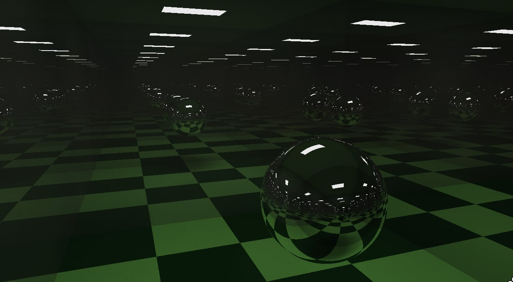
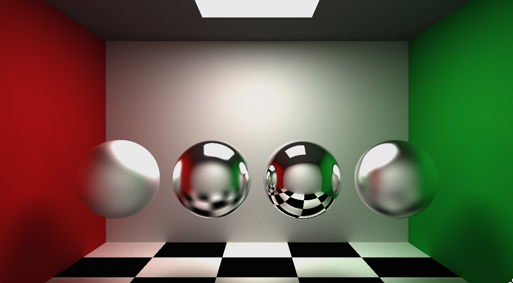
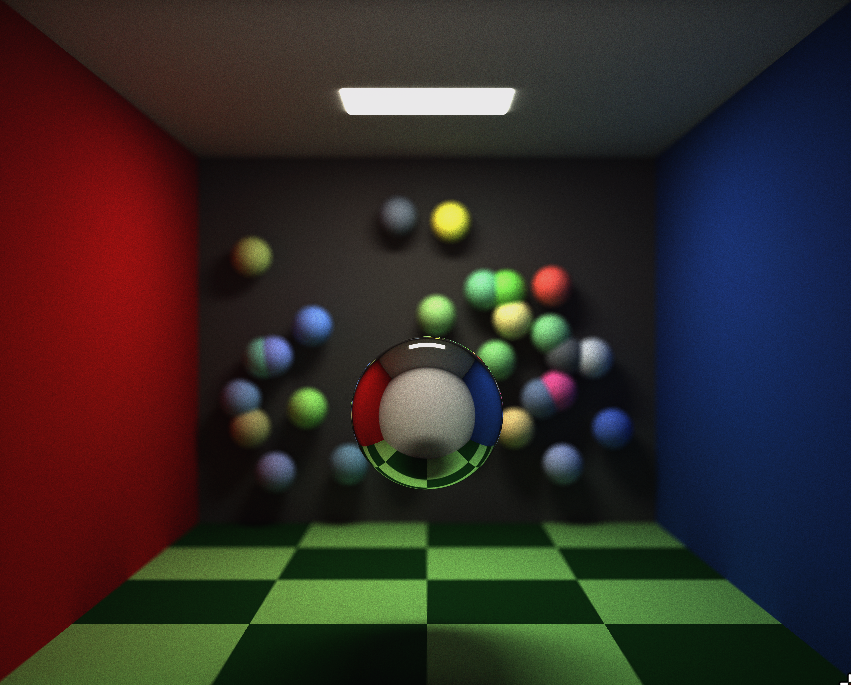
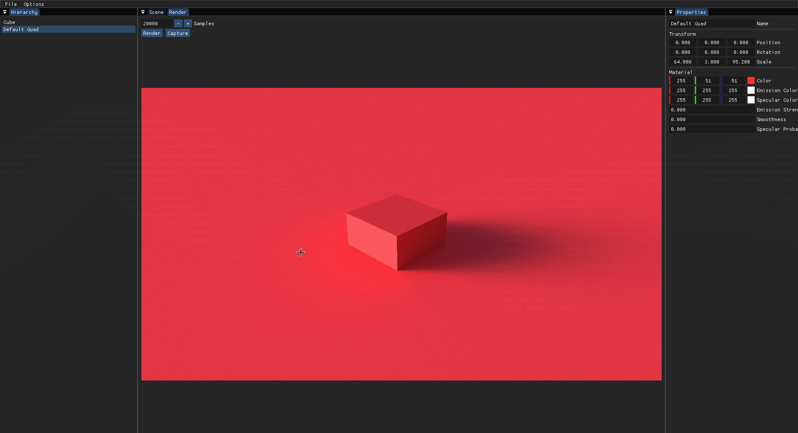

# Raytracer

Raytracer is a small GPU path tracer and scene editor written as a learning project. It renders the scene in real time, progressively reduces noise while the camera is still, and provides an ImGui editor for building and adjusting scenes.

## What is raytracing?

Raytracing is a way of rendering images by following rays of light. Instead of drawing only the visible surfaces of an object, it asks what a ray from the camera hits, how that surface reflects or scatters light, and where the next ray goes. Repeating that process creates shadows, reflections, soft lighting, and depth of field that feel more natural.

## How raytracing works

For every pixel, the renderer sends one or more rays from the camera into the scene. A ray can hit a sphere or a triangle. When it hits something, the material decides whether the ray scatters like a matte surface or reflects like a smooth one. Emissive surfaces add light to the result. The ray then continues for a limited number of bounces.

The shader uses random samples to make the lighting look less artificial. A single frame is noisy, so the renderer keeps an accumulation buffer and averages new frames with earlier ones. Leave the camera still for a moment and the image becomes cleaner. Moving the camera resets that accumulation.

## How this raytracer works

The application draws a full-screen quad with OpenGL. The fragment shader does the path tracing work on the GPU. Spheres and triangles are uploaded to the shader through uniform buffers, while cubes and quads are converted into triangles. The default scene uses a procedural sky, ground, and sun; emissive materials can also be used as light sources.

The scene starts empty and can be edited directly in the application. The editor has a Scene preview, a Hierarchy for selecting and deleting objects, and a Properties panel for editing transforms and materials.

## Editor features

- Create spheres, cubes, and quads from the Hierarchy context menu.
- Edit object names, transforms, colours, emission, smoothness, and specular probability.
- Adjust raytracing settings such as maximum bounces, rays per pixel, and accumulation.
- Adjust camera field of view, clipping planes, orientation, focus distance, divergence, and defocus.
- Render a fixed number of samples, cancel a render, and capture the current result as a PNG.
- Save and open project files. Projects are written to `~/Downloads/project.json`; captured images are written to `~/Downloads`.

## What this raytracer is written with

The program is written in C++17. OpenGL 3.3 is used to display the result and run the GLSL shaders. GLFW creates the window and handles input, Dear ImGui provides the editor UI, GLAD loads OpenGL functions, and GLM provides vector and matrix math. GLFW and GLM are fetched by CMake; Dear ImGui and the project sources are included in the repository.

## How to install

You need CMake 3.20 or newer, a C++17 compiler, Python 3 with the `glad` package, and the development files for OpenGL and X11 on Linux. On Debian or Ubuntu, install the required system packages with:

```bash
sudo apt install build-essential cmake python3 python3-pip libgl1-mesa-dev xorg-dev
python3 -m pip install glad
```

Then configure and build the project from its root directory:

```bash
cmake -S . -B build
cmake --build build
```

## How to run

Run the program from the build directory. This matters because the program loads the shaders from `../shaders`.

```bash
cd build
./raytracer
```

To fly the camera, hold the right mouse button over the Scene panel. Move with `W`, `A`, `S`, and `D`; use `E` or `Space` to move up and `Q` or left `Ctrl` to move down. Press `R` to reset the camera. Camera movement resets the accumulation buffer.

## Editing and rendering

Right-click an empty area of the Hierarchy and choose **Create Object** to add a sphere, cube, or quad. Select an object to edit it in Properties. Changes to the scene and camera automatically reset progressive accumulation.

Use the Options menu to change raytracing and camera settings. In the Render panel, set a target sample count and click **Render** for a progressive render. Click **Capture** to save the render as a PNG. **Ctrl+S** and **Ctrl+O** save and open the project file.

For code-driven scene setup, the object and scene types are in `src/objects` and `src/headers/scene.h`. The default runtime setup is in `Scene::Setup()` in `src/scene.cpp`.

## Screenshots






## Credits

Built with GLFW, GLAD, and GLM. The project also draws inspiration from the many raytracing tutorials and graphics programming resources shared by the open-source community.

Special thanks to [Sebastian Lague](https://www.youtube.com/watch?v=Qz0KTGYJtUk&list=PLFt_AvWsXl0dlgwe4JQ0oZuleqOTjmox3) for his excellent raytracing series.

Additional resources:
- [Ray Tracing in One Weekend](https://raytracing.github.io/)
- [Casual Shadertoy Path Tracing 1: Basic Camera, Diffuse, Emissive](https://blog.demofox.org/2020/05/25/casual-shadertoy-path-tracing-1-basic-camera-diffuse-emissive/)